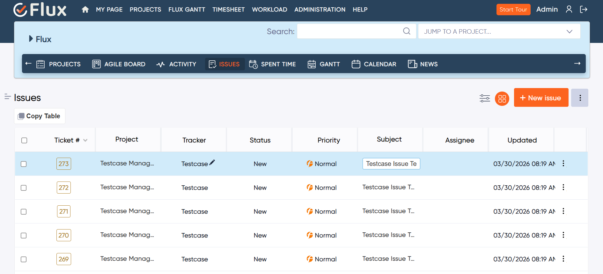
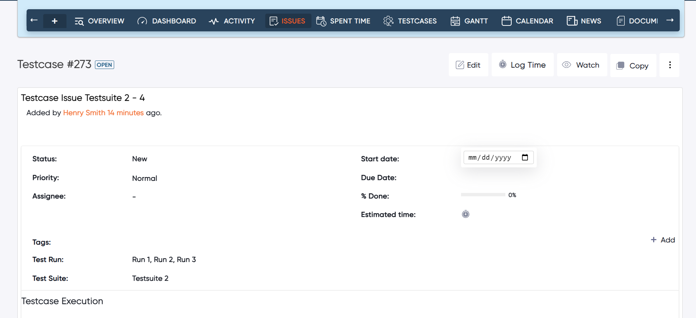

<p align="center">
  
</p>

<h1 align="center">Redmineflux Inline Issue Editor Plugin</h1>

<p align="center">
  <strong>Click-to-edit any Redmine issue field from the list or detail view — no full-page reload, no lost context.</strong>
</p>

<p align="center">
  
  
  
</p>

<p align="center">
  <a href="https://www.redmineflux.com/product/redmine-plugins/inline-editor/">Website</a> ·
  <a href="https://www.redmineflux.com/knowledge-base/">Knowledge Base</a> ·
  <a href="#features">Features</a> ·
  <a href="#api">API</a> ·
  <a href="#security">Security</a> ·
  <a href="#installation">Installation</a>
</p>

---

## Overview

The Inline Issue Editor Plugin adds click-to-edit directly to Redmine: the **issue list**, the **issue detail page**, the **project list** (table) and the **project cards / project page**. Click a value, change it, press Enter — it is saved at once, without a page reload, and recorded in the issue journal exactly like an edit made in the normal form.

```
Click field → Edit value → Save → Continue — no navigation, no reload, no lost context
```

Redmine's default edit flow requires opening a full form for every field change. Triaging ten issues means ten full-page loads. This plugin removes that overhead — while every edit still follows the same rules as the normal form (permissions, workflow, field rules, allowed values).

---

## Screenshots

<!--
  SCREENSHOT GUIDELINES FOR CONTRIBUTORS:
  - Resolution: 1280 x 720 pixels (16:9 ratio)
  - Format: PNG (no JPEG — text must be crisp)
  - Browser: Use Chrome at 100% zoom, hide bookmarks bar
  - Data: Use demo data with realistic names (no "test123" or "admin")
  - Theme: Use the Redmineflux Scarlet or Daisy theme
  - Crop: Full page width, no browser chrome, no OS taskbar
  - Naming: inline-editor-{view-name}.png (lowercase, hyphens)
  - Location: assets/images/
-->

### List View Inline Editing



*Edit any field directly from the issue list — filter and sort remain stable after each save.*

### Click-to-Edit on Issue Detail



*Click a field on the issue detail page to edit inline — no navigation to the full edit form.*

---

## Features

### Issue list — edit in the cell
- Edit the **subject, tracker, status, priority, assignee, category, target version, project, start date, due date, % done and estimated time** directly in the table cell; the cell width is locked while editing so the table never jumps
- **Story points and sprint** columns of the Agile Board plugin are editable too (when that plugin is installed)
- **Custom fields** in most formats: text, number, decimal, yes/no, date, list and multi-select list, key/value list, user, version, link and progress bar
- Searchable drop-downs for assignee, version and project; multi-select for multi-value custom fields; a date picker that follows Redmine's date format; estimated time accepts `5.5`, `5:30`, `2h30`, `30m`
- **Enter** saves, **Escape** or a click outside cancels; the list keeps its position, filters and sort order after every save
- Respects the person's rights **per row**: someone who may only edit *their own* issues gets pencils on their own issues only; dates, % done and priority of a **parent issue** that Redmine derives from its sub-tasks stay locked
- A value that is not allowed is refused with a clear message and the cell goes back to the old value; if *another* field of the issue is required and empty, the change is handed to Redmine's own edit form so its familiar error box explains it

### Issue detail page — click to edit
- Click any attribute of the issue (status, priority, assignee, category, version, dates, % done, estimated time, custom fields...), the **subject** or the **description**
- Drop-downs save the moment you choose; text fields save with Enter; the **description** opens in Redmine's own rich-text editor (the formatting toolbar, or CKEditor when that is your setting) with Save / Cancel
- Conflict protection: if someone else changed the issue while you were editing, your edit is refused with a "reload and try again" message instead of overwriting theirs
- After a save the history tab, properties and other blocks refresh in place; a short toast says "Saved" or explains why not

### Project list and project cards
- **Project table**: edit the **name, homepage, public / private flag, parent project, default version** and **project custom fields** in place (for people who may edit the project)
- **Project cards**: edit the project name and its custom fields on the card view; the **project's own page** lets you edit its custom fields in place
- After a save the cell shows what Redmine **stored**, so a value Redmine did not accept is reported as "not saved" instead of looking saved

### Rules the editor always follows
- **Same rules as the normal issue form**: workflow transitions, read-only fields, allowed values (the assignee must be a project member, version and category must belong to the project, % done 0–100, valid dates, subject length...) — checked on the server, not only hidden in the screen
- **Same journal and notifications**: every inline edit adds the usual journal entry (field, old value, new value, user, time), and Redmine sends its usual notifications for that journal
- Works for **any role** — no extra permission to set up; people see the pencils only where they may edit

### For administrators
- No settings: the plugin's **Configure** page is empty ("No data to display"); nothing to configure after installation
- Interface texts in **English and German** (other languages fall back to English)
- Swagger documentation of the API-key addresses at `/inplace_issue_editor/api_doc` (login required)
- Fixes for the security review are listed in [Security](#security)

---

## Tech Stack

| Component | Technology |
|-----------|-----------|
| **Backend** | Ruby on Rails (Redmine plugin) |
| **Frontend** | Plain JavaScript (ES6, no extra libraries), ERB templates |
| **Database** | None of its own (no tables, no migrations) |
| **Auth** | Redmine native (session; API key on the addresses listed in [API](#api)) |
| **API Docs** | Swagger UI 5.33 (built-in) |

For every signed-in user, every Redmine page loads the editor: a small configuration script in the page head (permissions, texts, date format), and at the end of the page the stylesheet `rf_inline_editor.css` and five scripts (`rf_inline_editor_core.js`, `rf_inline_editor_issue_show.js`, `rf_inline_editor_issue_table.js`, `rf_inline_editor_project_table.js`, `rf_inline_editor_project_card.js`). Each script decides from the configuration whether it does anything on the current page. Nothing is loaded for anonymous visitors.

---

## Installation

### Which branch to install

Your Redmine version is shown under **Administration > Information**. Install the release branch for your Redmine major version:

| Redmine | Plugin version | Branch to install |
|---------|----------------|-------------------|
| 7.x | 7.x.y | `release/7.0.0` |
| 6.x | 6.x.y | `release/6.0.0` |
| 5.x | 5.x.y (legacy, security fixes only) | `release/5.0.0` |

Releases are tagged on their branch. `master` is the development trunk and is not meant for production installs.

### Requirements

| Redmine | Ruby | Rails (comes with Redmine) |
|---------|------|----------------------------|
| 7.0 | 3.2 – 4.0 | 8.1 |
| 6.1 | 3.2 – 3.4 | 7.2 |
| 6.0 | 3.1 – 3.3 | 7.2 |
| 5.1 (legacy line) | 2.7 – 3.2 | 6.1 |

No gems, no database tables and no background services of its own.

### Install

```bash
# 1. Put the plugin in the plugins directory. The folder must be named inplace_issue_editor
#    (the plugin id; the API description is also read from plugins/inplace_issue_editor).
#    Use release/7.0.0 on Redmine 7.x, release/6.0.0 on Redmine 6.x.
cd /path/to/redmine/plugins
git clone -b release/7.0.0 https://github.com/zehntech/redmineflux-inline-editor-plugin.git inplace_issue_editor

# 2. Restart Redmine (the plugin has no gems and no database migrations;
#    for Passenger, otherwise restart your application server)
cd /path/to/redmine
touch tmp/restart.txt
```

### Verify

Navigate to **Administration > Plugins** — the Redmineflux Inline Issue Editor plugin is listed with the version of the package you installed. Open an issue list: a pencil appears on the cells you may edit.

---

## Configuration

**Administration > Plugins > Redmineflux Inline Issue Editor plugin > Configure** has no settings.

The plugin uses Redmine's native permission and field configuration. Inline editing is active immediately after installation for all fields the user's role permits.

### Enabling Custom Fields for Inline Editing

Issue and project custom fields configured in **Administration > Custom Fields** are automatically available for inline editing, if the user's roles may see them. Field type determines the input control rendered inline (text, drop-down, date picker, checkbox).

---

## Permissions

The Inline Issue Editor Plugin defines no permissions and no project module of its own. Inline editing is governed entirely by the existing Redmine role and field-level permission system.

| Redmine Permission | Inline Editing Behaviour |
|-------------------|--------------------------|
| `edit_issues` | Full inline editing available for all permitted fields |
| `edit_own_issues` | Inline editing of the issues the user created |
| `edit_project` | Inline editing of project fields |
| `view_project` plus `edit_issues`, `edit_own_issues` or `edit_project` | The member, version and sprint lists the drop-downs are filled from |
| `view_issues` | The issue category list of a project (category drop-down in the issue list) |
| Field-level restrictions (workflow read-only fields) | Inline edit control is not rendered for restricted fields, and the server refuses them |
| Read-only fields | Displayed as text — no click-to-edit activated |
| Project membership | Users outside the project cannot edit inline — standard Redmine rules apply |
| Issue visibility | An issue the user cannot see (a private issue, or a role limited to "own" or "assigned" issues) answers "not found" on every address of the plugin |

On a page without a project (for example the global issue or project list), the pencils are offered when one of the user's roles in any project has the permission; the server still checks each issue and project.

No permission configuration is needed after installation. Inline editing respects whatever permissions are already configured in your Redmine instance.

---

## API

### Addresses that accept an API key

These addresses need a login: the browser session (changes also need the page's CSRF token) or a Redmine API key in the `X-Redmine-API-Key` header (no token needed; the REST API must be enabled under **Administration > Settings > API**).

**Swagger UI** is available at `/inplace_issue_editor/api_doc` (login required; the description file is `/inplace-issue-editor-api.yaml`). It describes the addresses of this table.

| Action | Method | Endpoint |
|--------|--------|----------|
| Change fields of an issue | PUT | `/issues/:id/update_field` |
| Allowed status transitions | GET | `/issues/:id/allowed_status` |
| Active project members | GET | `/projects/:id/active_members` |
| Open versions for a project | GET | `/:project_id/all_versions` |
| Sprints (Agile Board) | GET | `/projects/:id/fetch_sprints` |
| Agile Board enabled for an issue's project | GET | `/:issue_id/check_agile_board_enabled` |
| Custom fields the user may see | GET | `/all_custom_fields` |
| Projects visible to the user | GET | `/all_projects` |
| Agile story point values | GET | `/agile_story_points` |
| Attachment lookup by file name | GET | `/issue_images?issueId=..&imageName=..` |

`update_field` applies the same rules as the normal issue form to the fields sent: workflow transitions, read-only fields, and allowed values (assignee must be a project member, version and category must belong to the project, progress 0–100, and so on). Send `issue[lock_version]` to be refused with `409` if the issue changed since you read it. Answers: `200` saved (with the new `lock_version`), `403` not allowed, `404` not found or not visible, `409` stale, `422` a value is not allowed.

```bash
# Example: change the subject and the progress of issue 42 with an API key
curl -X PUT -H "X-Redmine-API-Key: YOUR_KEY" -H "Content-Type: application/json" \
  -d '{"issue": {"subject": "New subject", "done_ratio": 40}}' \
  "https://redmine.example.com/issues/42/update_field"

# Example: allowed status transitions for an issue
curl -H "X-Redmine-API-Key: YOUR_KEY" "https://redmine.example.com/issues/42/allowed_status"
```

### Addresses for the browser session only

The editor reads issue and project data through these addresses so that the signed-in user's session can authenticate them (Redmine's own `.json` API addresses accept only an API key or HTTP Basic). They answer with the same JSON as Redmine's own REST API, do not accept an API key and are not in the Swagger description; use Redmine's REST API instead from scripts.

| Action | Method | Endpoint | Check |
|--------|--------|----------|-------|
| One issue (Redmine's issue API format, with children and attachments) | GET | `/issues/:id/rf_issue` | Issue visible |
| One project (with trackers, categories, modules, activities, issue custom fields) | GET | `/projects/:id/rf_project` | Project visible |
| Update a project (same as Redmine's project update; `204` on success) | PUT | `/projects/:id/rf_project` | `edit_project` |
| Issue categories of a project | GET | `/projects/:id/rf_issue_categories` | `view_issues` |
| Issue priorities | GET | `/rf_issue_priorities` | Login |

---

## Security

The plugin went through a full security review; the fixes are covered by the tests in `test/`.

- **Per-issue access control** on every address: an issue the user cannot see answers "not found" — also for the status list, the Agile Board check and the attachment lookup.
- **An inline edit can never do more than the normal issue form allows**: the model's own validation runs for every field sent (assignee, version, category, parent, progress, priority, dates...), workflow and read-only fields are enforced, a value that is not allowed is refused instead of silently dropped, and a stale edit is refused with `409`.
- **CSRF**: every request with the browser session needs the page's token; only a call with an API key and no session skips it. No API key is ever put into a page or script.
- **No script injection**: edited values are shown as text; a Link/homepage value is made a live link only for `http`, `https`, `ftp`, `mailto` or relative addresses; texts printed into scripts are escaped.
- **Only what the user may see is listed**: custom field definitions hidden from the user's roles are not sent, attachment lookups return no internal fields, the member/version/sprint lists are for people who may edit.
- **Clean errors**: odd bodies, wrong types, NUL characters and odd ids give a 4xx answer; unexpected errors show a general message and are logged, never printed back.
- **What is shown is what is stored**: after saving a project custom field the cell is filled from a fresh read, so a value Redmine dropped is reported as "not saved" instead of looking saved. HTML copied back into the page after a save is cleaned of handlers that fire by themselves.
- **API description** needs a login and takes its address from Redmine's settings.

Tests: `test/security/ie_security_test.rb` (28 tests) and the black-box attack script `test/security/live_attack_check.py`. A penetration test by an independent party has not been done.

---

## Running Tests

```bash
cd /path/to/redmine

# All tests
bundle exec rails test plugins/inplace_issue_editor/test

# Security tests only
bundle exec rails test plugins/inplace_issue_editor/test/security/ie_security_test.rb
```

`test/security/live_attack_check.py` is a separate script that attacks a running **test** server over HTTP; read its header for the setup. Never point it at a production server.

---

## Works With

| Plugin | How It Connects |
|--------|-----------------|
| **[Agile Board](https://www.redmineflux.com/product/redmine-plugins/agile-board/)** | The story-point and sprint columns of the issue list are editable in place, and the issue page's sprint and story-point rows refresh after an inline save. The sprint list offers the project's own sprints; the story-point values come from the Agile Board settings. |
| **[Checklist](https://www.redmineflux.com/product/redmine-plugins/checklist/)** | After an inline save on the issue page, the Checklist block is replaced with a fresh copy (so it turns read-only when the issue is closed inline) and the Checklist History tab is refreshed when it is open |
| **[Notification](https://www.redmineflux.com/product/redmine-plugins/notification/)** | An inline change creates the same journal as a form edit; the Notification plugin's in-app notifications and notification rules run on that journal, so they also fire for inline edits |

Inline saves do not run the issue form's controller hooks (`controller_issues_edit_before_save`, `controller_issues_edit_after_save`); a plugin that reacts only to those hooks does not see inline edits.

---

## Uninstall

```bash
cd /path/to/redmine

# Remove plugin (there are no migrations to roll back)
rm -rf plugins/inplace_issue_editor

# Restart
touch tmp/restart.txt
```

---

## FAQ

**Does inline editing bypass any Redmine permissions?**
No. The plugin respects all existing Redmine role and field-level permissions. A user can only edit a field inline if their role permits editing that field through the standard form. Inline editing is a UI improvement — no permission rules are bypassed.

**Which fields can be edited inline?**
On the issue list: subject, tracker, status, priority, assignee, category, target version, project, start and due date, % done, estimated time, story points and sprint (Agile Board), and most custom field formats. On the issue page: the same attributes plus the description. On the project list and cards: name, homepage, public flag, parent, default version and project custom fields. Fields you may not edit, or that Redmine computes (a parent issue's dates, % done and priority), show no pencil.

**Are inline edits recorded in the issue journal?**
Yes. Every inline edit is logged in the issue journal with the same detail as a standard form edit: changed field, old value, new value, timestamp, and the user who made the change. The audit trail is identical regardless of whether the edit was made inline or through the full edit form.

**Which Redmine versions are supported?**
Redmine 6.x and 7.x: install `release/6.0.0` on Redmine 6 and `release/7.0.0` on Redmine 7. Redmine 5.x is a legacy line on `release/5.0.0` that receives security fixes only. See [Installation](#installation).

**What happens when two people edit the same issue at once?**
On the issue page the editor sends the issue's version with each edit; if someone else changed the issue meanwhile, the edit is refused with a message to reload instead of overwriting their change.

**Why do I get "not found" for an issue I know exists?**
You cannot see that issue (a private issue, or your role only shows "own" or "assigned" issues). The plugin answers the same as for an issue that does not exist.

**Does the list reset after an inline save?**
No. The list position, active filters, and sort order remain stable after every inline save. The page does not reload — the updated value replaces the old one in place and the list stays exactly where it was.

---

## Known Limitations

- **No offline editing** — Inline edits require an active connection to the Redmine server. There is no offline mode with sync.
- **One issue at a time** — there is no bulk inline edit; use Redmine's own bulk edit for many issues.
- **No mobile app** — The plugin works in mobile browsers but there is no dedicated iOS/Android app.
- **Not every column is editable** — id, author, dates created/updated/closed, parent, spent time, relations, watchers, tags, attachments and similar read-only columns have no pencil; a project's identifier, description and status are not editable inline.
- **Interface languages** — English and German; other languages show the English texts.
- **No conditional field visibility** — Inline editing does not support conditional field display rules. If a field is visible in the list, it is editable inline for users with the appropriate permission.
- **Shared sprints** — the sprint drop-down lists only the sprints of the issue's own project.

---

## Licence

- The whole plugin (Ruby and ERB code, JavaScript, CSS, images and documentation) is licensed under the GNU General Public License v2 – see [`LICENSE`](LICENSE) and [`LICENSING-NOTICE.txt`](LICENSING-NOTICE.txt).
- Third-party libraries keep their own licences – see [`THIRD-PARTY-NOTICES.md`](THIRD-PARTY-NOTICES.md).
- "Redmineflux" and its logo are trademarks of Zehntech Technologies Inc.

## Release Notes

See [RELEASE_NOTES.md](RELEASE_NOTES.md).

---

## Support

| Channel | Link |
|---------|------|
| Knowledge Base | [redmineflux.com/knowledge-base](https://www.redmineflux.com/knowledge-base/) |
| Plugin Docs | [knowledge-base/plugins/inline-editor-plugin](https://www.redmineflux.com/knowledge-base/plugins/inline-editor-plugin/) |
| Email | support@redmineflux.com |
| Website | [redmineflux.com](https://www.redmineflux.com) |

## More from Redmineflux

This plugin is free. Redmineflux also makes paid Redmine plugins, bundles and a managed Redmine Cloud:

- **Paid plugins** – Agile Board, Gantt Chart, Timesheet, Helpdesk, Test Case Management, Invoice and more: [see all plugins and prices](https://www.redmineflux.com/redmine-plugins-pricing/)
- **Bundles** – several plugins together at a lower price: [compare bundles](https://www.redmineflux.com/redmine-plugin-combos-pricing/)
- **Managed Redmine Cloud** – Redmine with our plugins, hosted and maintained for you: [Redmineflux Cloud](https://www.redmineflux.com/cloud-redmine/)
- **AI for Redmine** – Crux Chat, Crux Agents and the MCP Server: [AI project management for Redmine](https://www.redmineflux.com/ai-project-management-for-redmine/)

**Need help?** GitHub issues are turned off for this repository. Please email
support@redmineflux.com or use the [contact page](https://www.redmineflux.com/contact-us/).
Plugin page: [Inline Editor plugin on redmineflux.com](https://www.redmineflux.com/product/redmine-plugins/inline-editor/)

---

<p align="center">
  
</p>

<p align="center">
  Redmine plugins for modern teams.<br/>
  Built by <a href="https://www.zehntech.com">Zehntech Technologies Inc.</a>
</p>

<p align="center">
  <a href="https://www.redmineflux.com">Website</a> ·
  <a href="https://www.redmineflux.com/redmine-plugin-combos-pricing/#all-plugins">All Plugins</a> ·
  <a href="https://www.redmineflux.com/about-us/">About Us</a>
</p>
